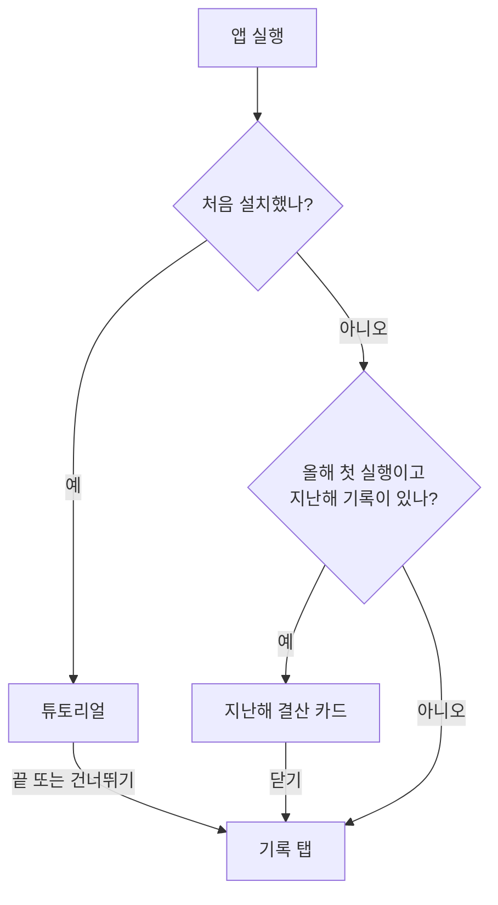
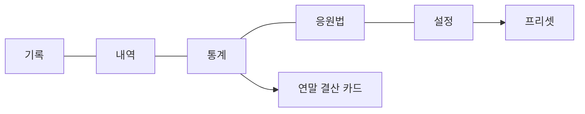
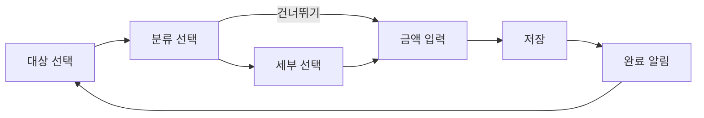
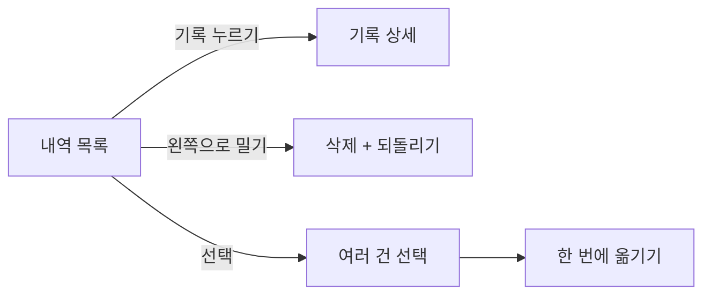
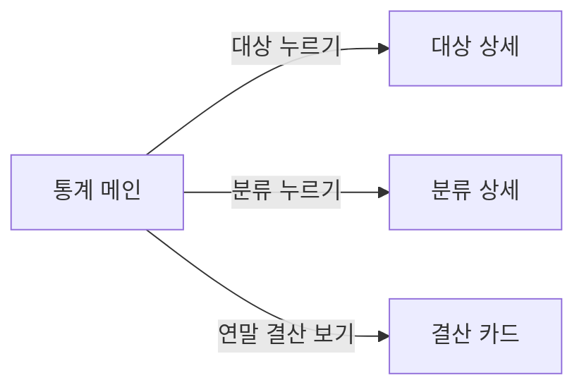
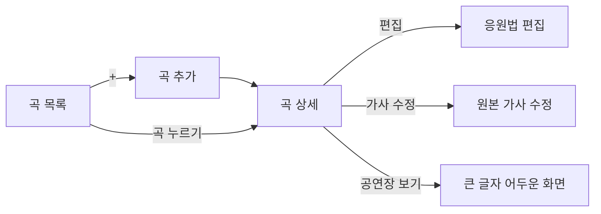

# 화면 스토리보드

[README](README.md)의 명세를 화면으로 옮긴 구상입니다. 실제 디자인이 아니라 화면에 무엇이 있고 어디로 넘어가는지를 보여 주는 간단한 목업입니다.

- 화면은 갤럭시 세로 화면 기준입니다.
- `[버튼]`은 누르는 버튼, `( )`는 선택 항목, `▸`는 다음 화면으로 넘어가는 동작입니다.
- 예시의 `가수 A`, `가수 B`, 금액은 모두 설명을 위한 가짜 데이터입니다.

## 목차

1. [전체 흐름](#1-전체-흐름)
2. [처음 실행과 튜토리얼](#2-처음-실행과-튜토리얼)
3. [기록 탭](#3-기록-탭)
4. [내역 탭](#4-내역-탭)
5. [통계 탭](#5-통계-탭)
6. [연말 결산 카드](#6-연말-결산-카드)
7. [응원법 탭](#7-응원법-탭)
8. [설정 탭](#8-설정-탭)
9. [삭제 확인창](#9-삭제-확인창)

---

## 1. 전체 흐름

### 앱을 열었을 때



### 하단 탭

```
┌──────────────────────────────
│ (화면 내용)
│
├──────────────────────────────
│  기록   내역   통계   응원법   설정
└──────────────────────────────
```



---

## 2. 처음 실행과 튜토리얼

처음 설치했을 때만 자동으로 나옵니다. 게임 튜토리얼처럼 **단계마다 실제 화면이 바뀌고**, 눌러야 할 곳이 반짝이며 강조됩니다. 예시는 저장되지 않습니다.

```
┌──────────────────────────────
│ 기록                         ← 단계마다 바뀌는 실제 화면
│ 누구에게 썼나요?
│  [기타]   (( + 추가 ))         ← 반짝이는 강조
│
│ ░░░░░░ 어둡게 가린 나머지 ░░░░░░
│  ┌────────────────────────
│  │ 1 / 11
│  │ 대상 추가
│  │ (설명)
│  │ [건너뛰기]   [이전] [다음]
│  └────────────────────────
│        ( 시작하기 자리 )
└──────────────────────────────
```

| 단계 | 보이는 화면 | 강조하는 곳 |
|---|---|---|
| 1 대상 추가 | 기록 화면 | `+ 추가` |
| 2 이름 넣기 | 새 대상 추가 창, `가수 A` 입력 | `추가` |
| 3 대상 고르기 | 기록 화면 | `가수 A` |
| 4 분류 고르기 | 분류 선택 | `행사` |
| 5 세부 고르기 | 세부 선택 | `콘서트` |
| 6 금액 넣고 저장 | 금액 입력 | `저장` |
| 7 내역 보기 | 내역 | 방금 저장한 기록 |
| 8 환불 넣기 | 기록 수정 | 환불 금액 칸 |
| 9 통계 보기 | 통계 | `월 / 연` 전환 |
| 10 응원법 외우기 | 곡 상세 | `응원법 / 원본 / 외우기` 전환 |
| 11 테마 꾸미기 | 테마와 꾸미기 | 테마 색 |

- 강조된 곳을 직접 누르거나 `[다음]`을 누르면 다음 단계로 넘어갑니다.
- 안내 칸은 화면 아래쪽에 고정되고, 높이는 가장 긴 단계에 맞춰 고정되어 단계를 넘겨도 버튼 위치가 그대로입니다.
- 첫 단계에는 `[이전]`이 없고, `[건너뛰기]`를 누르면 바로 기록 탭으로 갑니다.
- 마지막 단계에는 `[다음]`이 사라지고 `[이전]`이 오른쪽 끝에 붙습니다. `[시작하기]`는 안내 칸 아래 가운데에 크게 따로 나타납니다.

```
│  ┌────────────────────────
│  │ 11 / 11  테마 꾸미기
│  │ (설명)
│  │ [건너뛰기]           [이전]
│  └────────────────────────
│         [ 시작하기 ]
```

- `[시작하기]`를 누르면 예시가 사라지고 `기타`만 있는 빈 상태의 기록 화면으로 갑니다.

---

## 3. 기록 탭

### 기록 흐름



- 고른 항목은 화면 위쪽에 `가수 A > 행사 > 콘서트`처럼 쌓여 보이고, 누르면 그 단계로 돌아갑니다.
- 세부를 건너뛰면 그 분류의 `기타`로 저장합니다.

### 3-1. 대상 선택

```
┌──────────────────────────────
│ 기록              11월 13일  [편집]
│ 🔔 내일 정기 결제가 있어요
│ 이번 달 지출          359,300원
│
│ 누구에게 썼나요?
│  ● 가수 A          128,500원  ›
│  ● 가수 B           22,000원  ›
│  ● 그룹 C           34,000원  ›
│  ...
│  ● 기타             50,600원  ›
│  [ + 대상 추가 ]
│
│ 최근 기록 …
└──────────────────────────────
```

- 대상마다 이번 달 금액이 보이고, 누르면 그 대상의 분류 목록으로 갑니다.
- `[+ 대상 추가]`를 누르면 이름과 프리셋을 고르는 창이 열립니다.

### 3-2. 대상의 분류

```
┌──────────────────────────────
│ ◂ (가수 A)                 [편집]
│ 어디에 썼나요?      11월 128,500원
│  행사              124,000원  ›
│  상품                    0원  ›
│  경비                    0원  ›
│  멤버십              4,500원  ›
│  서포트                  0원  ›
│  기타                    0원  ›
│  [ + 분류 추가 ]
└──────────────────────────────
```

### 3-3. 분류의 세부

```
┌──────────────────────────────
│ ◂ (가수 A) › (행사)        [편집]
│ 자세히 고를까요?    11월 124,000원
│  콘서트            124,000원  ›
│  팬미팅                  0원  ›
│  ...
│  기타                    0원  ›
│  [ + 세부 추가 ]
│ [ 건너뛰기 · 기타로 저장 ]
└──────────────────────────────
```

### 편집 모드

세 화면 모두 항목을 길게 누르거나 `[편집]`을 누르면 편집 모드가 됩니다.

```
│  ≡  행사            124,000원   ⋮
│  ≡  상품                  0원   ⋮
```

- `≡`를 끌어 순서를 바꿉니다.
- `⋮`를 누르면 아래에서 창이 올라와 이름 바꾸기, 데이터만 삭제, 삭제를 합니다. 창은 아래로 끌어내려 닫을 수 있습니다.
- `기타`에는 삭제 버튼이 없습니다.

### 3-4. 금액 입력

```
┌──────────────────────────────
│ ◂  가수 A > 행사 > 콘서트
│
│            154,000 원
│
│  날짜  2026.11.13 (오늘)    [변경]
│  매달 반복                  (  ○)
│  ▾ 메모
│
│   1   2   3
│   4   5   6
│   7   8   9
│  00   0   ⌫
│
│             [저장]
└──────────────────────────────
```

- 숫자 키패드가 바로 열립니다.
- `▾ 메모`는 눌렀을 때만 펼쳐집니다.
- 날짜를 미래로 바꾸면 `예정` 표시가 붙습니다.
- `매달 반복`을 켜면 정기 결제로 등록됩니다. [정기 결제](#8-1-정기-결제)를 참고하세요.

`기타`를 골랐을 때는 내용 칸이 함께 나타납니다.

```
│ ◂  가수 A > 기타 > 기타
│
│            30,000 원
│
│  기타 내용 (선택) [            ]
```

### 3-5. 저장 후

```
│  ✓ 저장했어요
│    가수 A > 행사 > 콘서트  154,000원
│                          [되돌리기]
```

알림이 사라지면 대상 선택 화면으로 돌아갑니다.

### 대상 추가 창

```
┌──────────────────────────────
│ 대상 추가
│ 새 대상                     [닫기]
│  이름 [가수 C            ]
│  프리셋  (가수용) (배우용) (취미용) (빈 목록)
│  행사, 경비, 상품, 멤버십, 서포트와
│  각 세부 버튼이 들어가요.
│            [ 추가 ]
└──────────────────────────────
```

- 분류와 세부 추가 창은 이름만 넣습니다.
- 이미 있는 이름이면 새로 만들지 않습니다.

---

## 4. 내역 탭

### 4-1. 내역 목록

```
┌──────────────────────────────
│ 내역                    [선택]
│ 대상 ( 전체 ▾ )
│
│ 11월 13일
│  가수 A  행사 > 콘서트   154,000원
│  가수 B  상품 > 앨범      22,000원
│
│ 11월 2일
│  가수 A  상품 > 기타      30,000원
│          환불 30,000원     → 0원
│
│ 12월 24일                  예정
│  가수 B  행사 > 팬미팅    77,000원
├──────────────────────────────
│  기록   내역   통계   응원법   설정
└──────────────────────────────
```



### 4-2. 기록 상세와 수정

```
┌──────────────────────────────
│ ◂  기록 수정              [삭제]
│
│  날짜      2026.11.13
│  대상      가수 A          ▸
│  분류      행사            ▸
│  세부      콘서트          ▸
│  결제 금액  154,000원
│  환불 금액       0원
│  집계 금액  154,000원
│  메모      
│
│             [저장]
└──────────────────────────────
```

- 대상, 분류, 세부를 누르면 다른 항목으로 옮길 수 있습니다.
- 환불 금액을 바꾸면 집계 금액이 바로 바뀝니다.
- 환불 금액은 결제 금액보다 크게 입력할 수 없습니다.

### 4-3. 여러 건 옮기기

```
│ 2건 선택됨          [취소]
│  ☑ 가수 A  행사 > 콘서트   154,000원
│  ☑ 가수 A  행사 > 기타     30,000원
│  ☐ 가수 B  상품 > 앨범     22,000원
│
│            [옮기기 ▸]
```

`[옮기기 ▸]`를 누르면 대상, 분류, 세부를 고르는 화면이 나옵니다.

---

## 5. 통계 탭

### 5-1. 통계 메인

```
┌──────────────────────────────
│ 통계            ( 월 | 연 )
│        ◂  2026년 11월  ▸
│
│  이번 달 총액   261,000원
│
│  1위 대상  가수 A   184,000원
│  1위 분류  행사     231,000원
│
│  대상 랭킹
│   1  가수 A  ███████   184,000
│   2  가수 B  ███        77,000
│
│  분류 랭킹
│   1  행사    ████████  231,000
│   2  상품    █          30,000
│
│        [2026 연말 결산 보기]
├──────────────────────────────
│  기록   내역   통계   응원법   설정
└──────────────────────────────
```

- `월 | 연`으로 기간을 바꾸고, `◂ ▸`로 이전과 다음 기간으로 넘깁니다.
- `연`을 고르면 연간 대상별 금액이 나옵니다.



### 5-2. 대상 상세

```
┌──────────────────────────────
│ ◂  가수 A          2026년 11월
│
│  합계  184,000원
│
│  행사      154,000
│   ├ 콘서트  154,000
│   └ 기타         0
│  상품       30,000
│   └ 기타     30,000
└──────────────────────────────
```

---

## 6. 연말 결산 카드

새해 첫 실행 때 자동으로 열리고, 통계에서도 열 수 있습니다.

```
┌──────────────────────────────
│                         [닫기]
│
│      2026년 당신은
│
│      1,284,000원을
│      썼어요
│
│
│       ● ○ ○ ○ ○ ○
│  [공유]
└──────────────────────────────
         ◂ 손가락으로 밀기 ▸
```

| 카드 | 큰 글씨 | 아래 작은 글씨 |
|---|---|---|
| 1 | 올해 총액 | 없음 |
| 2 | 가장 많이 쓴 달은 5월 | 2위 9월, 3위 12월 |
| 3 | 가장 많이 쓴 대상은 가수 A | 2위 가수 B, 3위 기타 |
| 4 | 가장 많이 쓴 분류는 행사 | 2위 상품, 3위 기타 |
| 5 | 응원법을 가장 많이 펼친 달은 8월 | 2위 7월, 3위 9월 |
| 6 | 가장 많이 펼친 곡은 가수 A의 곡 1 | 2위, 3위 곡 |

- 카드는 옆으로 넘어가는 애니메이션으로 바뀌고, 손가락으로 밀어 넘길 수 있습니다.
- 데이터가 없는 카드는 건너뜁니다.
- `[공유]`를 누르면 지금 카드를 이미지로 만들어 폰의 공유 창을 띄웁니다.

---

## 7. 응원법 탭

### 7-1. 곡 목록

```
┌──────────────────────────────
│ 응원법                   [ + ]
│ 🔍 곡 제목 검색
│
│ 가수 A
│   곡 1
│   곡 2
│ 가수 B
│   곡 3
├──────────────────────────────
│  기록   내역   통계   응원법   설정
└──────────────────────────────
```



### 7-2. 곡 추가

```
┌──────────────────────────────
│ ◂  곡 추가
│
│  대상  ( 가수 A ▾ )   [ + ]
│  제목  [곡 1              ]
│
│  가사
│  ┌────────────────────
│  │ (여기에 붙여넣기)
│  └────────────────────
│        [붙여넣기]
│
│  링크  [+ 링크 추가]
│
│             [저장]
└──────────────────────────────
```

### 7-3. 곡 상세

```
┌──────────────────────────────
│ ◂  가수 A · 곡 1      [편집] [⋮]
│ ( 응원법 | 원본 | 외우기 )
│
│  가사 첫째 줄
│  ▓▓가사 둘째 줄▓▓      ← 떼창 색
│     「 구호 」          ← 추가 응원
│  가사 셋째 줄
│
│  링크
│   ▸ 응원법 영상
│
│            [공연장 보기]
└──────────────────────────────
```

외우기 모드에서는 색칠한 부분과 추가 응원이 칸으로 가려집니다.

```
│ ( 응원법 | 원본 | 외우기 )
│                [모두 보기] [모두 가리기]
│
│  가사 첫째 줄
│  ██████████████       ← 누르면 열림
│     ██████            ← 누르면 열림
│  가사 셋째 줄
```

`[⋮]` 메뉴에는 `가사 수정`, `응원법 초기화`, `곡 삭제`가 있습니다.

### 7-4. 응원법 편집

```
┌──────────────────────────────
│ ◂  응원법 편집             [완료]
│
│  가사 첫째 줄
│  가사 [둘째 줄] ← 손가락으로 선택
│  가사 셋째 줄
│
│  색  ● ● ● ●   [지우기]
│  [+ 추가 응원 넣기]
└──────────────────────────────
```

- 가사를 선택하고 색을 누르면 떼창으로 표시됩니다.
- `[+ 추가 응원 넣기]`를 누른 뒤 넣을 위치를 누르고 구호를 입력합니다.
- 원본 가사는 이 화면에서 바뀌지 않습니다.

---

## 8. 설정 탭

```
┌──────────────────────────────
│ 설정
│
│  프리셋                      ▸
│  테마와 꾸미기               ▸
│  정기 결제                   ▸
│  데이터 내보내기 (JSON)       ▸
│  데이터 불러오기             ▸
│  튜토리얼 다시 보기          ▸
│  앱 정보                     ▸
├──────────────────────────────
│  기록   내역   통계   응원법   설정
└──────────────────────────────
```

### 8-1. 정기 결제

```
┌──────────────────────────────
│ ◂  정기 결제
│
│  매달 나가는 돈   9,490원
│
│  [14일] 가수 A                (●  )
│         멤버십 › 버블 · 4,500원
│         내일 나가요
│  [25일] 가수 B                (●  )
│         멤버십 › 유튜브 멤버십 · 4,990원
│
│  알림 시간   결제 전날 오후 8:00 ›
│
│        [+ 정기 결제 추가]
└──────────────────────────────
```

- 결제 전날 `내일은 가수 A의 버블 4,500원이 나가는 날이에요` 알림을 보냅니다.
- 스위치를 끄면 이후의 자동 기록과 알림이 멈춥니다.

### 8-2. 프리셋

```
┌──────────────────────────────
│ ◂ 프리셋
│ (가수용) (배우용) (취미용) [+ 새 프리셋]
│ 이 프리셋으로 만든 대상 5개 · 가수 A, …
│
│  행사                 세부 7 ▴   ✕
│   (콘서트✕) (팬미팅✕) … (기타) [+ 세부]
│  경비                 세부 3 ▾   ✕
│  ...
│  [ + 분류 추가 ]
└──────────────────────────────
```

- 분류나 세부를 추가하면, 이 프리셋으로 만든 대상이 있을 때 묻습니다.

```
│ 이미 이 프리셋을 쓰는 대상에도 추가할까요?
│ 행사 › 쇼케이스 항목만 추가돼요. 지출 기록과
│ 다른 분류는 바뀌지 않고, 같은 이름이 이미 있는
│ 대상은 건너뛰어요.
│ (가수 A) (가수 B) (그룹 C) …
│    [프리셋에만]      [대상에도 추가]
```

- `✕`로 빼면 프리셋에서만 빠지고 이미 만든 대상은 그대로입니다.

---

## 9. 삭제 확인창

삭제는 모두 기록 화면의 편집 모드에서 하며, 범위와 건수를 보여 주고 한 번 더 묻습니다.

**세부 삭제**

```
│ 콘서트를 삭제할까요?
│ 가수 A › 행사에서만 콘서트가 사라져요.
│ 기록 3건은 가수 A › 행사 › 기타로 옮겨지고,
│ 기타 내용에 "콘서트"가 들어가요.
│        [취소]     [삭제]
```

**분류 삭제**

```
│ 가수 A의 행사를 삭제할까요?
│ 가수 A에서만 행사와 세부 버튼 8개가 사라져요.
│ 기록은 가수 A › 기타 › 기타로 옮겨져요.
```

**대상 삭제**

```
│ 가수 A를 삭제할까요?
│ 가수 A의 분류와 세부 버튼, 지출 기록, 응원법이
│ 모두 삭제되고 되돌릴 수 없어요.
```

**데이터만 삭제**

```
│ 가수 A › 행사 › 콘서트의 기록만 삭제할까요?
│ 기록 3건이 삭제돼요. 콘서트는 그대로 남아요.
```
