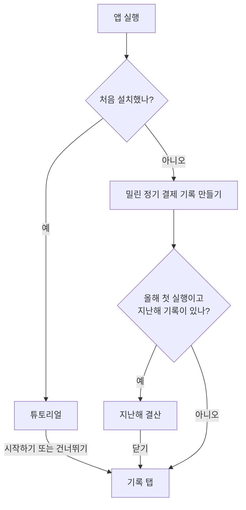
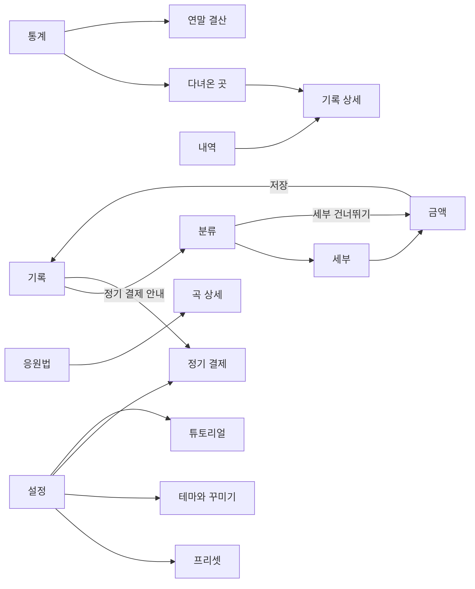

# 화면 스토리보드

[README](README.md)의 요구사항을 화면 단위로 옮긴 문서입니다. 화면에 무엇이 있고 누르면 어디로 가는지를 적습니다. 실제 모양은 디자인 캔버스 시안을 기준으로 합니다.

- 갤럭시 세로 화면 기준입니다.
- `[버튼]`은 누르는 곳, `▸`는 다음 화면이나 창으로 넘어가는 동작입니다.
- `가수 A`, 금액 등은 설명용 예시입니다.

## 목차

1. [전체 흐름](#1-전체-흐름)
2. [공통 동작](#2-공통-동작)
3. [튜토리얼](#3-튜토리얼)
4. [기록](#4-기록)
5. [내역과 기록 상세](#5-내역과-기록-상세)
6. [통계, 다녀온 곳, 연말 결산](#6-통계-다녀온-곳-연말-결산)
7. [응원법](#7-응원법)
8. [설정](#8-설정)
9. [테마와 꾸미기](#9-테마와-꾸미기)
10. [확인 창 문구](#10-확인-창-문구)

---

## 1. 전체 흐름

### 앱을 열었을 때



### 화면 지도

하단 탭: `기록` `내역` `통계` `응원법` `설정`



---

## 2. 공통 동작

| 요소 | 동작 |
|---|---|
| 아래에서 올라오는 창(시트) | `[닫기]`, 바깥 누르기, 아래로 끌어내리기로 닫음 |
| 알림(토스트) | 약 2초 뒤 저절로 사라짐. 옆으로 밀어서 바로 닫을 수 있음 |
| 편집 모드 | `[편집]` 또는 항목 길게 누르기. `≡` 끌어서 순서, `⋮`로 이름 바꾸기·데이터만 삭제·삭제 |
| 확인 창 | 지워지거나 옮겨지는 범위와 건수를 보여 주고 `[취소]` `[삭제]` |
| 금액 표시 | 목록마다 이번 달 금액. 0원은 흐리게 |

---

## 3. 튜토리얼

처음 설치했을 때 한 번 나옵니다. 단계마다 실제 화면이 바뀌고, 누를 곳이 반짝입니다. 반짝이는 곳을 눌러도 다음으로 넘어갑니다. 예시는 저장되지 않습니다.

```
┌──────────────────────────────
│ (단계마다 바뀌는 실제 화면)
│        (( 반짝이는 곳 ))
│ ░░░░░ 어둡게 가린 나머지 ░░░░░
│  ┌────────────────────────
│  │ 3 / 12   대상 고르기
│  │ (설명)
│  │ [건너뛰기]     [이전] [다음]
│  └────────────────────────
│        ( 시작하기 자리 )
└──────────────────────────────
```

| 단계 | 화면 | 반짝이는 곳 |
|---|---|---|
| 1 대상 추가 | 기록 (기타만 있음) | `+ 대상 추가` |
| 2 이름과 프리셋 | 새 대상 창, `가수 A` + 프리셋 | `추가` |
| 3 대상 고르기 | 기록 (금액 붙은 목록) | `가수 A` |
| 4 분류 고르기 | 분류 목록 | `행사` |
| 5 세부 고르기 | 세부 목록 + 건너뛰기 | `콘서트` |
| 6 금액 넣고 저장 | 금액 (날짜, 매달 반복) | `저장` |
| 7 내역 보기 | 내역 | 방금 기록 |
| 8 수정하기 | 기록 상세 (보기 전용) | `수정` |
| 9 환불 넣기 | 기록 수정 | 환불 칸 |
| 10 통계 보기 | 통계 | `월 / 연` |
| 11 응원법 외우기 | 곡 상세 | `응원법 / 원본 / 외우기` |
| 12 테마 꾸미기 | 테마와 꾸미기 | 테마 카드 |
| 13 시작 | 기록 (기타만) | 아래 `[시작하기]` |

- 안내 칸 높이는 가장 긴 단계에 맞춰 고정해서, 단계를 넘겨도 버튼이 움직이지 않습니다.
- 마지막 단계는 `[다음]` 대신 안내 칸 아래에 `[시작하기]`가 나오고 축하 효과가 터집니다.

---

## 4. 기록

### 4-1. 대상

```
┌──────────────────────────────
│ 기록             11월 13일  [편집]
│ 🔔 내일 정기 결제가 있어요  ▸ 정기 결제
│ 이번 달 지출            499,890원  ▸ 통계
│ 누구에게 썼나요?
│  ● 가수 A          128,500원  ›
│  ● 가수 D          146,800원  ›
│  ● 기타             50,600원  ›
│  [ + 대상 추가 ]
└──────────────────────────────
```

- 대상을 누르면 ▸ 분류.
- `+ 대상 추가` ▸ 새 대상 창: 이름 + 프리셋(가수용, 배우용, 취미용, 빈 목록) 고르기.
- 금액 화면에서 저장하고 돌아오면 `가수 A › 행사 › 콘서트 154,000원을 저장했어요` 알림.

### 4-2. 분류 · 세부

```
┌──────────────────────────────
│ ‹ (● 가수 A) › (행사)        [편집]
│ 자세히 고를까요?     11월 124,000원
│  콘서트            124,000원  ›
│  팬미팅                  0원  ›
│  기타                    0원  ›
│  [ + 세부 추가 ]
│  [ 건너뛰기 · 기타로 저장 ]      ← 세부 화면만
└──────────────────────────────
```

- 분류와 세부는 같은 모양이고, 대상마다 따로 가집니다. `기타`는 지울 수 없습니다.
- 대상에 사진을 넣었으면 분류·세부 화면 위쪽에 사진이 깔립니다(9장).

### 4-3. 금액

```
┌──────────────────────────────
│ ‹ (가수 A) › (행사) › (콘서트)
│            154,000 원
│ 날짜        2026. 11. 13 (금) 오늘 ›   ▸ 달력
│ 장소        KSPO DOME ›               ▸ 장소 창
│ 매달 반복                   ( ○ )
│ 메모 추가                       ▾
│  1  2  3
│  4  5  6
│  7  8  9
│ 00  0  ⌫
│ [ 저장 ]
└──────────────────────────────
```

- 미래 날짜는 `예정` 표시.
- 매달 반복을 켜면 `매달 13일 · 전날 저녁 8시에 알림`.
- 금액이 0이면 `저장`이 꺼져 있음. 저장하면 ▸ 기록(대상) 화면.

### 4-4. 장소 창

```
┌──────────────────────────────
│ 어디였나요?                [닫기]
│ [ 국내 | 해외 ]
│ [ 검색어 입력              ]
│ 전에 간 곳 / 검색 결과
│  KSPO DOME   서울 송파구…   카카오  ✓
│  Tokyo Dome (東京ドーム)    OSM
│  성수 팝업스토어   이름만
│ [ 검색 없이 '…' 이름만 남기기 ]
│ 장소 검색: 카카오 / © OpenStreetMap 기여자
│ [장소 빼기]      [ 이 장소로 ]
└──────────────────────────────
```

- 국내는 카카오(입력하면서 찾기), 해외는 OpenStreetMap(`검색` 버튼으로 찾기).
- 해외에서 한글로 찾아서 안 나오면 영어나 현지어로 찾으라고 안내.
- 국내 탭에서 못 찾으면 해외 탭을 안내.

---

## 5. 내역과 기록 상세

### 5-1. 내역

```
┌──────────────────────────────
│ 내역                       [선택]
│ [전체 대상 ▾] [전체 기간 ▾]
│ 11월 14일
│  가수 A  멤버십 › 버블   4,500원  예정
│ 11월 13일
│  가수 A  행사 › 콘서트  124,000원
│          환불 30,000원
└──────────────────────────────
```

- 기록을 누르면 ▸ 기록 상세.
- `[선택]` ▸ 여러 개 골라 `[옮기기]` `[삭제]`. 삭제 뒤 알림에 `되돌리기`.

### 5-2. 기록 상세 → 수정

```
┌──────────────────────────────          ┌──────────────────────────────
│ ‹ 기록 상세              [수정]          │ ‹ 기록 수정               [취소]
│ 날짜     2026. 11. 13 (금)              │ 날짜     2026. 11. 13 (금) ›
│ 대상     ● 가수 A                       │ 대상     ● 가수 A ›
│ 분류     행사                     ▸     │ 분류     행사 ›
│ 세부     콘서트                         │ 세부     콘서트 ›
│ 장소     KSPO DOME  [지도 열기]          │ 장소     KSPO DOME ›
│ 결제 금액   154,000                     │ 결제 금액  [154,000]
│ 환불 금액    30,000                     │ 환불 금액  [ 30,000]
│ 집계 금액   124,000원                    │ 집계 금액   124,000원
│ 메모     메모 없음                       │ 메모     [          ]
│                                        │ [삭제]       [ 저장 ]
└──────────────────────────────          └──────────────────────────────
```

- 처음에는 보기 전용입니다. `[수정]`을 눌러야 고칠 수 있고, `[삭제]`도 수정 중에만 보입니다.
- `[취소]`는 고친 내용을 버리고 보기로 돌아갑니다. `[저장]`은 `저장했어요` 알림 후 보기로 돌아갑니다.
- 보기 중 장소를 누르면 국내는 카카오맵, 해외는 구글 지도에서 열립니다.
- 대상을 바꾸면 같은 이름의 분류·세부를 찾고, 없으면 `기타`로 옮기고 기타 내용에 이전 이름을 적습니다.
- 환불이 결제 금액보다 크면 경고하고 `저장`이 꺼집니다.

---

## 6. 통계, 다녀온 곳, 연말 결산

### 6-1. 통계

```
┌──────────────────────────────
│ 통계                     [월|연]
│        ◂  2026년 11월  ▸
│ 이번 달 총액        499,890원
│ 1위 대상 가수 D   1위 분류 행사
│ 대상 랭킹  ▇▇▇▇ …
│ 분류 랭킹  ▇▇▇ …
│ 세부 랭킹  1 콘서트 124,000 …
│ [📍 다녀온 곳]  [2026 연말 결산]
└──────────────────────────────
```

- `▸`는 이번 기간에서 멈춥니다.

### 6-2. 다녀온 곳

```
┌──────────────────────────────
│ ‹ 다녀온 곳             [올해|전체]
│ 2026년에  6곳 · 9번 다녀왔어요
│ (많이 간 순) (최근 순) (많이 쓴 순)
│ 1 KSPO DOME 카카오         3번 ▴
│   ● 가수 A · 마지막 11월 13일  477,000원
│   11월 13일  가수 A · 행사 › 콘서트  124,000원  ▸ 기록 상세
│   [카카오맵에서 열기]  [이름 바꾸기]
│ 2 올림픽홀 카카오           2번 ▾
│ 3 Tokyo Dome OSM           1번 ▾
│ 4 성수 팝업스토어 이름만      1번 ▾
└──────────────────────────────
```

- 같은 날 같은 장소의 기록은 한 번 다녀온 걸로 셉니다.
- `이름 바꾸기`는 보이는 이름만 바꿉니다. 이름만 남긴 장소는 `장소 연결하기`로 나중에 검색해서 연결합니다.

### 6-3. 연말 결산

```
┌──────────────────────────────
│        두구두구…
│   2026년의 좋아하는 것들
│   결산이 도착했어요
│        [ 열어 보기 ]        ← 처음 열 때 축하 효과
└──────────────────────────────
```

카드 7장을 옆으로 밀어서 넘깁니다. 지금 카드는 크게, 양옆 카드는 작고 흐리게 보입니다.

| 카드 | 예시 |
|---|---|
| 1 올해 총액 | 2,166,880원, 한 달 평균 |
| 2 많이 쓴 달 TOP 3 | 5월, 9월, 12월 |
| 3 대상 TOP 3 | 가수 A 702,000원 … |
| 4 분류 TOP 3 | 행사 968,000원 … |
| 5 가장 많이 간 곳 TOP 3 | KSPO DOME 3번 … |
| 6 응원법 많이 펼친 달 TOP 3 | 8월 41번 … |
| 7 많이 펼친 곡 TOP 3 | 가수 A · 곡 1 58번 … |

- `[공유]` ▸ 폰 공유 창(이미지). `[닫기]` ▸ 통계.

---

## 7. 응원법

### 7-1. 곡 목록

- 대상별로 곡을 모아 보고, 제목으로 검색합니다.
- `+ 곡 추가` ▸ 창: 대상 고르기, 제목, 가사 붙여넣기.

### 7-2. 곡 상세

```
┌──────────────────────────────
│ ‹ 가수 A                  [편집]
│ 곡 1
│ [응원법 | 원본 | 외우기]   [공연장 모드]
│ 가사 첫째 줄이 여기에 와요
│ 둘째 줄 [다 같이 부르는 부분]     ← 떼창 색
│ 「 하나 둘 셋 」                   ← 추가 응원
│ 링크  ▸ 영상, 응원법 출처 …
└──────────────────────────────
```

| 보기 | 떼창 | 추가 응원 |
|---|---|---|
| 응원법 | 색으로 강조 | 표시 |
| 원본 | 일반 가사 | 숨김 |
| 외우기 | 칸으로 가림, 눌러서 열기 | 칸으로 가림 |

- 외우기에는 `[모두 보기]` `[모두 가리기]`가 있습니다.
- 공연장 모드는 `응원법` 보기에서만 켜집니다(큰 글자, 어두운 화면, 화면 꺼짐 방지).

### 7-3. 편집 모드

- 도구: `떼창 색칠`(4색 + 지움) / `추가 응원 넣기`.
- 추가 응원: 단어를 누르고 `단어 앞` / `단어 뒤` / `줄 아래` 중 위치를 고른 뒤 글을 넣습니다. 넣기 전에 미리 보여 줍니다. 넣은 응원을 누르면 고치거나 지웁니다.
- 아래 막대: `[가사 수정]` `[초기화]` `[곡 삭제]`.

---

## 8. 설정

```
┌──────────────────────────────
│ 설정
│ 프리셋                     ▸
│ 테마와 꾸미기          ●   ▸
│ 정기 결제                  ▸
│ 튜토리얼 다시 보기          ▸
│ 내보내기 (JSON)            ▸ 창
│ 불러오기                   ▸ 파일 고르기 → 덮어쓰기 확인
│ 구글 계정 연동 (2단계)       흐리게
│ 앱 정보                    ▸ 창
└──────────────────────────────
```

### 8-1. 정기 결제

- 결제마다 `매달 14일 · 가수 A · 멤버십 › 버블 · 4,500원`과 켜기/끄기 스위치.
- 줄을 누르면 ▸ 수정 창(저장, 삭제). `+ 정기 결제 추가` ▸ 대상 → 분류 → 세부를 차례로 고르고 금액·결제일.
- `알림 시간` ▸ 이틀 전 / 전날 / 당일 + 시각.

### 8-2. 프리셋

- 위에 프리셋 탭(가수용, 배우용, 취미용 …)과 `+ 새 프리셋`.
- 분류를 펼치면 세부 칩이 보이고 `✕`로 빼고 `+`로 넣습니다.
- 넣거나 빼면 적용 범위 창: `프리셋에만` / `대상 전체` / `대상 골라서`(체크).

---

## 9. 테마와 꾸미기

```
┌──────────────────────────────
│ ‹ 테마와 꾸미기
│ 앱 테마
│ [라이트] [흑백] [사진 테마 1] [+ 사진으로 만들기]
│ 글자색     잘 보여요   자동 · 검정 ›
│ 글꼴                 기본 글꼴 ›
│ 대상별 꾸미기
│  [사진] 가수 A     ●   색 · 사진 ›
│ 분류별 색
│  (● 행사) (● 체험) …
│ [ ‘흑백’ 테마로 적용 ]
└──────────────────────────────
```

- 테마 카드를 누르면 화면이 미리 바뀌고, 아래 버튼으로 적용합니다.
- **사진으로 만들기:** 사진 고르기 → 결과 화면.
  - 뽑은 색, 미리보기, 어디에 어떤 색이 쓰이는지(배경, 카드, 강조, 보조 강조, 글자)를 보여 줍니다.
  - 줄을 누르면 그 색만 바꿉니다.
  - `[다른 조합 5개 보기]` / `[스포이드로 찍기]`(쓸 자리를 고르고 사진을 누름).
  - 색이 한 가지뿐인 사진은 전부 그 색이 되고 다른 조합은 꺼집니다.
  - `[이 테마 적용]` ▸ `사진 테마 1`로 추가.
- **글자색:** `자동(추천)` 또는 직접. 대비가 낮으면 `잘 안 보여요`라고만 알립니다.
- **글꼴:** 목록(이름을 그 글꼴로 미리 보기), `+ 글꼴 파일 넣기`, `✕` 지우기.
- **대상별 꾸미기:** 줄을 누르면 ▸ 창: 표시 색, 배경 사진(없음 / 넣은 사진 / 사진 넣기). 사진은 색을 바꾸지 않습니다.

---

## 10. 확인 창 문구

| 상황 | 제목 | 내용 |
|---|---|---|
| 대상 삭제 | 가수 A를 삭제할까요? | 분류, 세부, 지출 기록 n건, 응원법 n곡이 모두 지워져요. |
| 분류 삭제 | 가수 A의 행사를 삭제할까요? | 가수 A에서만 행사와 세부 버튼 n개가 사라져요. 기록 n건은 가수 A › 기타 › 기타로 옮겨지고, 기타 내용에 이전 이름이 들어가요. |
| 세부 삭제 | 콘서트를 삭제할까요? | 가수 A › 행사에서만 콘서트가 사라져요. 기록 n건은 가수 A › 행사 › 기타로 옮겨지고, 기타 내용에 "콘서트"가 들어가요. |
| 데이터만 삭제 | 가수 A › 행사의 기록만 삭제할까요? | 기록 n건이 삭제돼요. 분류와 세부 버튼은 그대로 남아요. |
| 기록 삭제 | 이 기록을 삭제할까요? | 내역과 통계에서 빠져요. |
| 여러 기록 삭제 | 기록 n건을 삭제할까요? | 지운 뒤 잠깐 되돌리기가 나와요. |
| 곡 삭제 | 곡 1을 삭제할까요? | 가사와 응원법이 모두 지워져요. |
| 응원법 초기화 | 응원법을 초기화할까요? | 원본 가사는 그대로 남아요. |
| 불러오기 | 지금 데이터를 덮어쓸까요? | 지금 폰에 있는 기록은 모두 바뀌어요. |
| 정기 결제 삭제 | 정기 결제를 삭제할까요? | 이미 만든 기록은 그대로 남아요. |
